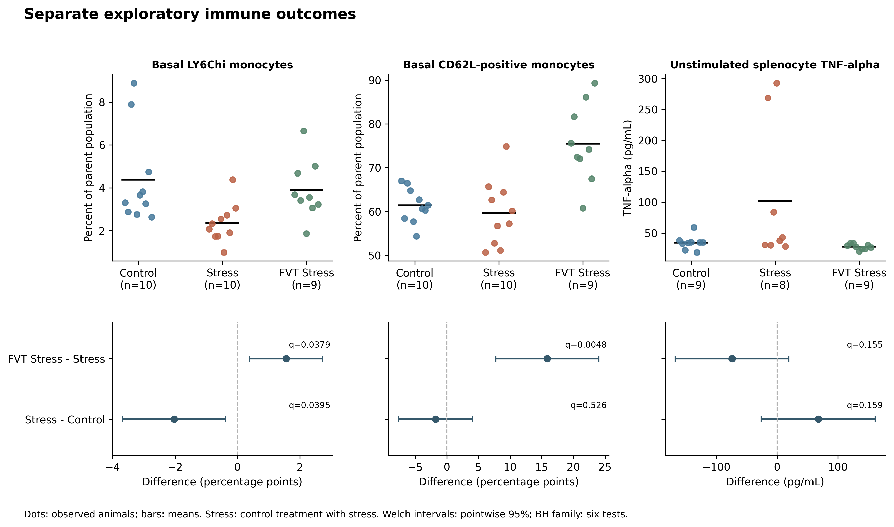
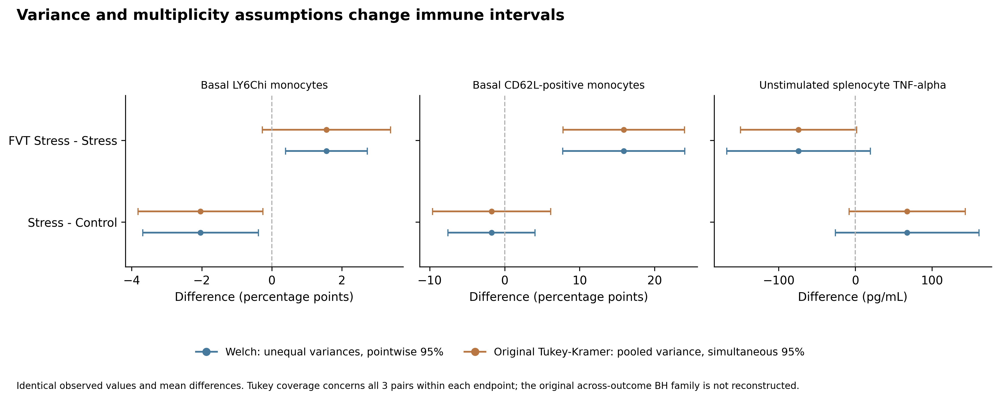

# Gut phageome stability and stress-related immune responses

## Biological question

Do mice whose gut phage communities change less during chronic stress have
different immune phenotypes at the end of the experiment? Answering that
question requires repeated viral measurements from individual mice and a
reliable link to their immune assays. A change in diversity between treatment
groups cannot supply that information.

The starting point is [Ritz et al. (2024), *Nature Microbiology*](https://doi.org/10.1038/s41564-023-01564-y),
which examined chronic social defeat stress and fecal virome transplantation
(FVT) in mice. Its public source workbook supports a reanalysis of selected
immune outcomes. The processed viral abundance tables and animal crosswalk
needed for the ecological question were not recovered from the inspected
releases. The analysis therefore examines the immune comparisons separately:
which outcomes differ with stress or FVT, and how much those conclusions depend
on the statistical comparison, measurement scale and assumed independent unit.
Raw recipient reads are public: literal Stress/FVT labels identify 17 candidate
complete Before/After pairs, but those compressed reads alone total about
85.6 GB. Reprocessing exceeds the local storage budget, and the authors'
processing, recalibration and exclusion key is still needed to validate the
linkage. The limitation concerns accessible processed inputs, validated linkage
and local compute capacity; it does not imply that viral measurements were absent.

## Data and experimental design

The source workbook contains 20 animal rows from the initial stress experiment
and 30 from the FVT experiment. The immune reanalysis uses the latter, which has
three groups of ten male C57BL/6J mice: Control, Control Stress and FVT Stress.
Available measurements vary by assay; the selected comparisons contain eight
to ten observed animals per group. Source values and missing cells are retained
without outlier removal or imputation.

The three selected outcomes cover two different sampling occasions:

| Measurement | Material and timing | Unit |
|---|---|---|
| LY6Chi monocyte proportion | Blood on day 19, before forced swim and after 16 defeat days | Percent of parent population |
| CD62L-positive fraction of LY6Chi monocytes | Same basal blood collection | Percent of parent population |
| Unstimulated splenocyte TNF-alpha | Culture supernatant from terminal day-23 spleen collection, after 19 defeat days | pg/mL |

Here, **basal means before the acute forced-swim test**, after chronic stress
has already begun. These are endpoint immune phenotypes. The blood percentages
describe relative cell populations; the cytokine measurement describes ex vivo
splenocyte output.

The metagenomic accession [PRJNA970614](https://www.ebi.ac.uk/ena/browser/view/PRJNA970614)
contains 104 specimens: 77 individual recipient bulk samples, eight enriched
pools and 19 inocula. Those categories cannot be counted as 104 mice. The
publication describes individual pre/post bulk-derived viral profiles as well
as pooled viromes, but the archived code release provides a script PDF rather
than the referenced processed matrices. [Data availability and linkage](docs/data_feasibility.md)
sets out what was recovered and what is still required.

The archive also includes a heat-inactivated-FVT-labelled arm: ten Before and
ten After recipient samples, ten inocula and two pools. The retrieved workbook
has no immune rows for that arm. The article describes three phenotype groups
and discusses an inactivated control as future work, leaving the archived
arm's relationship to the reported cohort unresolved. Its immune outcomes,
allocation and processing records are a priority [data requirement](docs/data_requirements.md).
An active-versus-inactivated comparison could be informative, although heating
may alter constituents other than viral infectivity.

## Analysis

Each outcome has two comparisons: **Control Stress minus Control** and
**FVT Stress minus Control Stress**. Welch tests estimate differences in raw
means, with pointwise 95% confidence intervals and one Benjamini–Hochberg (BH)
correction across all six tests. The endpoints were chosen after reading the
published results, so this is an exploratory reanalysis.

Three checks help interpret those estimates. Rank comparisons assess ordering
rather than raw means. Leaving out each observed animal in turn shows the
influence of individual observations. A reconstruction of the original
three-group model explains differences between the present Welch tests and the
published Tukey comparisons. [Methods](docs/methods.md) gives the definitions
and [detailed results](docs/results.md) reports the complete comparisons.

Post hoc checks additionally use treatment-balanced ID ranges, conditional
control-cage means and log-scale TNF-alpha. The ranges and shared ID prefixes
are observable; their meaning as batches or cages is unverified. These
[design and scale sensitivities](docs/design_sensitivity.md) retain the original
six comparisons and use explicitly separate exploratory multiplicity families.

## Immune findings



*Dots are observed animals and horizontal bars are arithmetic group means.
The TNF concentration panel uses a log y-axis for visibility. The lower
panels show raw mean differences with pointwise 95% Welch intervals. The q
values use the six-test BH family. [Observations](results/tables/figure4_data.csv),
[contrast estimates](results/tables/immune_contrasts.csv) and [vector PDF](figures/figure4_immune.pdf).*

| Outcome | Comparison | n, first / second | Mean difference (95% CI) | BH q |
|---|---|---:|---|---:|
| LY6Chi monocytes | Stress − Control | 10 / 10 | −2.03 percentage points (−3.68, −0.38) | 0.0395 |
| LY6Chi monocytes | FVT Stress − Stress | 9 / 10 | +1.56 percentage points (0.39, 2.72) | 0.0379 |
| CD62L-positive fraction | Stress − Control | 10 / 10 | −1.76 percentage points (−7.58, 4.06) | 0.5265 |
| CD62L-positive fraction | FVT Stress − Stress | 9 / 10 | +15.87 percentage points (7.73, 24.02) | 0.00480 |
| Splenocyte TNF-alpha | Stress − Control | 8 / 9 | +67.54 pg/mL (−26.18, 161.26) | 0.1591 |
| Splenocyte TNF-alpha | FVT Stress − Stress | 9 / 8 | −74.13 pg/mL (−167.78, 19.51) | 0.1551 |

**The LY6Chi pattern depends partly on the assumed independent unit.**
The stressed control group is lower than Control, while
FVT Stress is higher than stressed control. The FVT comparison is also sensitive
to the analysis model: its Welch P value is 0.01265, whereas the reconstructed
Tukey–Kramer P value is 0.106409, matching the article's reported 0.106. The
pairwise observations and mean difference are unchanged; Tukey's variance
estimate also uses the third group.

Treating the six integer-prefix control groups as putative cages changes the
Stress–Control estimate to −1.75 percentage points and its sensitivity BH q to
0.153, compared with −2.03 and q = 0.0395 at the animal level. Equal cage
weighting changes the estimand as well as the uncertainty. This does not prove
those prefixes are actual cages. Adjustment for inferred ID strata changes
the estimates little, and every FVT effect direction holds within both strata;
direction agreement does not establish replicated significance.

**The CD62L-positive fraction is higher with FVT, but a preceding stress deficit
is not established.** Its FVT contrast is clearly positive under the selected
Welch analysis, while the stress–control interval crosses zero. Describing both
outcomes as a common restoration response would obscure that difference.

**TNF-alpha depends on what is being compared.** Two large observations make
the stressed group highly dispersed. Its FVT raw-mean contrast has a wide
interval crossing zero, while the rank comparison gives q = 0.0110 in the
separate sensitivity family. The rank result describes ordering of the
observations and does not resolve uncertainty about the mean.

The log-scale FVT/Stress geometric-mean ratio is 0.43 (pointwise 95% CI
0.19–0.97), with raw P = 0.0441 and a two-test sensitivity BH q = 0.0883.
That analysis describes another estimand and does not provide a new
confirmatory result. No observed value was removed or replaced.



*Welch intervals allow unequal variances and cover each contrast separately.
Tukey–Kramer intervals use the three-group pooled variance and cover all three
pairs within each endpoint. Their different widths explain why an unchanged
mean difference can produce a different inferential conclusion.
[Source table](results/tables/figure8_data.csv), [vector PDF](figures/figure8_method_comparison.pdf)
and [original-method reconstruction](docs/original_analysis_review.md).*

Effect directions remain the same after leaving out each animal, although the
uncertainty changes. Conditional bounds for the missing percentage assays also
retain positive FVT-minus-stress mean differences among the source rows. Those
bounds describe possible values within this cohort; they do not provide
confidence intervals. The [sensitivity report](docs/phenotype_robustness.md)
explains the assumptions and gives the full results.

## Interpretation

The immune outcomes show different treatment-associated patterns rather than
a single measure of immune recovery. These observations and related treatment
effects originate in Ritz and colleagues' experiment. This reanalysis adds an
explicit comparison of estimands, uncertainty and statistical assumptions.

Housing is part of the stress–control comparison: controls were group housed,
while stressed animals were singly housed. Both stressed groups share the
reported housing regime. The definitive cage/allocation key, upstream exclusions
and assay detection thresholds remain unresolved. The selected assays
cannot identify which viral constituent, bacterial response or other treatment
component accounts for an immune difference.

The phageome question remains open. Repeated recipient viral profiles linked
to the immune rows would permit an association with endpoint phenotype. A claim
about **within-mouse immune change** would additionally require an appropriate
immune baseline. [Limitations](docs/limitations.md) and [scope of the contribution](docs/novelty_assessment.md)
describe these boundaries.

## Reproducing the analysis

Use Python 3.11 or newer and the pinned requirements. Small frozen public inputs
are included, so the analysis can run offline after package installation.

```bash
python -m venv .venv
source .venv/bin/activate
python -m pip install -r requirements.txt
python scripts/run_all.py --config config/analysis.yaml --threads 1 --offline
```

On Windows PowerShell, activate with `.\.venv\Scripts\Activate.ps1` instead.
Use `--resume` to verify and reuse completed stages or `--validate-only` to run
the software checks. The selected workflow runs serially and excludes raw
sequencing reads and large reference databases. [Reproduction guide](docs/reproducibility.md)
contains the environment requirements, measured comparisons and resource use.

A fresh committed-source Windows replay reproduced all 39 scientific files
exactly on 23 October 2026, with 213 tests executed, six platform skips and no
failures or errors. See the [execution evidence](docs/reproduction_validation.md)
for the source revision and comparison scope.

## Repository guide

| Location | Contents |
|---|---|
| [docs/](docs/README.md) | Methods, interpretation, data availability and technical appendices |
| [data/manifests/](data/manifests/) | Source URLs, input sizes, checksums and review records |
| [data/processed/](data/processed/) | Extracted observations with workbook-cell lineage |
| [results/tables/](results/tables/) | Estimates, sensitivity analyses and figure data |
| [figures/](figures/) | PNG and vector PDF figures |
| [src/pisa/](src/pisa/) and [scripts/](scripts/) | Analysis functions and ordered workflow |
| [tests/](tests/) | Independent estimator checks and workflow tests |

## Citation and license

Cite [Ritz et al. (2024)](https://doi.org/10.1038/s41564-023-01564-y) for the
experiment and source measurements. Project citation metadata are in
[CITATION.cff](CITATION.cff). Project code uses the [MIT license](LICENSE);
upstream data and archived scripts retain their own licenses and attribution,
as recorded in [data provenance](docs/data_provenance.md) and
[third-party notices](docs/third_party_notices.md).
